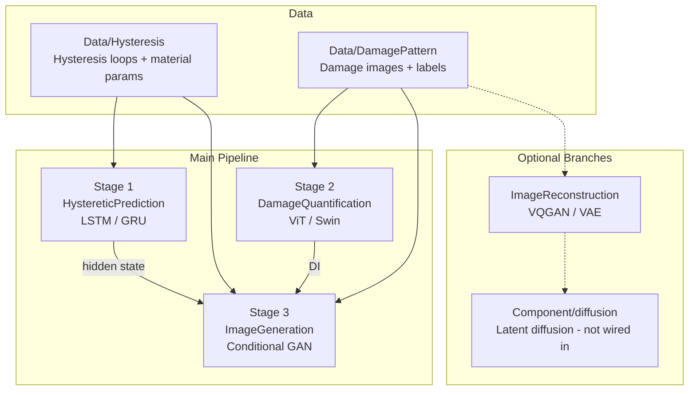
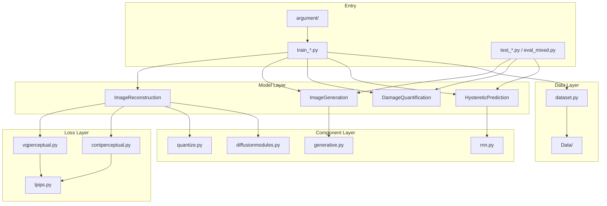
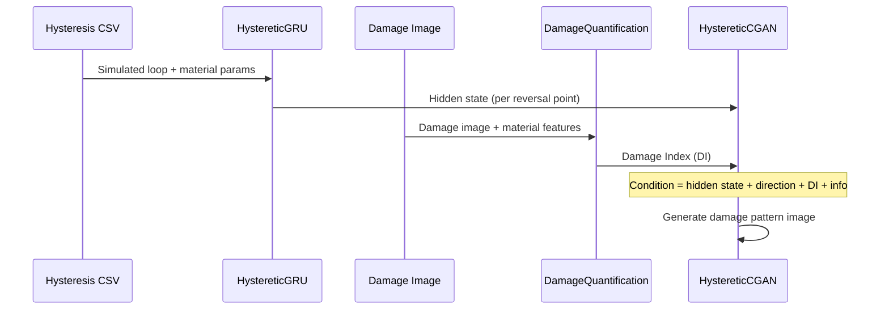

# Project Architecture Overview

This repository implements a **physics-guided deep learning framework** for RC bridge columns. It predicts hysteretic structural response, quantifies damage, and generates corresponding damage pattern images from structural signals and metadata.

Built with **PyTorch** and **PyTorch Lightning**.

---

## Core Pipeline

The project is organized around **three main stages** and **two optional branches**:



| Stage | Model | Input | Output | Training Script | Argument File |
|-------|-------|-------|--------|-----------------|---------------|
| 1 | `HystereticLSTM` / `HystereticGRU` | Simulated hysteresis loop + material features | Predicted force, hidden state | `train_hysteresis.py` | `argument/argument_hysteresis.py` |
| 2 | `DamageQuantification` | Damage image + material features | Damage Index (DI) | `train_quantification.py` | `argument/argument_quantification.py` |
| 3 | `HystereticCGAN` / `Baseline` | Hidden state + direction + DI + noise | Damage pattern image | `train_mixed.py` | `argument/argument_mixed.py` |
| Branch | `VQGAN` / `VAE` | Damage image | Reconstructed image / latent code | `train_reconstruction.py` | `argument/argument_reconstruction.py` |

---

## Directory Structure

```text
intership-project/
|
|-- argument/                  # CLI argument definitions (one file per train script)
|   |-- argument_hysteresis.py
|   |-- argument_quantification.py
|   |-- argument_mixed.py
|   `-- argument_reconstruction.py
|
|-- scripts/                   # Helper scripts (Colab quickstart)
|-- job/                       # HPC batch training shell scripts (PBS)
|-- .vscode/                   # VS Code / Cursor debug configurations
|
|-- Data/                      # Primary training data
|   |-- Hysteresis/            #   Hysteresis CSV/XML, material metadata (Mander params)
|   `-- DamagePattern/         #   Damage images, label.csv, train/val splits
|
|-- src/                       # Core source code
|   |-- dataset.py             #   All Dataset classes
|   |-- utils.py
|   |-- model/
|   |   |-- HystereticPrediction.py   # Stage 1
|   |   |-- DamageQuantification.py   # Stage 2
|   |   |-- ImageGeneration.py        # Stage 3
|   |   |-- ImageReconstruction.py    # Optional branch
|   |   `-- Component/                # Shared neural network building blocks
|   |       |-- generative.py         #   DCGAN generator / discriminator
|   |       |-- rnn.py                #   LSTM, GRU, Predictor MLP
|   |       |-- diffusionmodules.py   #   Encoder / Decoder (U-Net style)
|   |       |-- quantize.py           #   Vector quantization (VQ-VAE)
|   |       `-- diffusion/              #   DDPM / DDIM / PLMS (requires external ldm)
|   `-- losses/
|       |-- lpips.py                  #   Perceptual loss (pretrained VGG)
|       |-- contperceptual.py         #   Full VAE loss
|       |-- vqperceptual.py           #   Full VQGAN loss
|       `-- segmentation.py           #   Unused in current pipeline
|
|-- train_hysteresis.py        # Training entry points
|-- train_quantification.py
|-- train_mixed.py
|-- train_reconstruction.py
|-- test_*.py                  # Inference scripts
|-- eval_mixed.py              # Automated evaluation (PSNR, SSIM, FID, R²)
|-- plot_peak.py               # Visualization utility
|
|-- mander/                    # Raw / intermediate data (processed into Data/)
|-- PDSHM/                     # Resampled analysis outputs
|-- eval/                      # Manual visual comparison images (gt vs methods)
|-- taming/                    # LPIPS weight cache (auto-created at runtime)
|
|-- results/                   # Training outputs (checkpoints, args.json) — gitignored
|-- evaluation/                # eval_mixed.py outputs — gitignored
|-- generation/                # test_mixed.py outputs — gitignored
|
|-- README.md
|-- requirements.txt
|-- ARCHITECTURE.md            # This file
|-- colab_minimal_pipeline.ipynb
`-- *.ipynb                    # Other analysis notebooks
```

### Removed / Legacy (no longer in repo)

The following were removed during cleanup to keep a single primary training path:

- `argument/argument.py` (unused legacy entry)
- `train_hysteresis_cv.py`, `test_hysteresis_cv.py`, `argument/argument_hysteresis_cv.py`
- `job/HysteresisPrediction/train_GRU_cv.sh`

---

## Code Layers



| Layer | Role | Analogy |
|-------|------|---------|
| `argument/` | Hyperparameters, output paths | Configuration |
| `train_*.py` | Wire data, model, and trainer | Pipeline orchestration |
| `src/model/*.py` | Full Lightning modules with training logic | Finished products |
| `src/model/Component/` | Pure `nn.Module` building blocks | Parts |
| `src/losses/` | Loss functions | Scoring criteria |
| `src/dataset.py` | Data loading and preprocessing | Raw material handling |

---

## Data Flow (Full Pipeline)



### Dataset Classes (`src/dataset.py`)

| Dataset | Used By | Returns |
|---------|---------|---------|
| `HystereticDataset` | Stage 1 | Simulated loop, test force, material info |
| `DamageIndexDataset` | Stage 2 | Image, features, DI |
| `PatternLoopDataset` | Stage 3 training | Image + hidden state + direction + DI + info |
| `InteriorLoopDataset` | Stage 3 inference | Hidden state + direction (no ground-truth image) |
| `DamagePatternDataset` | Reconstruction branch | Damage images only |

---

## Model Internals

### Stage 1 — Hysteresis Prediction

```text
HystereticLSTM = LSTM(time-series) -> Predictor(MLP) -> force
HystereticGRU  = GRU(time-series)  -> Predictor(MLP) -> force
```

- Input: 7-dimensional signal features over time (drift, force, material params)
- Output: Predicted experimental force at each timestep
- Loss: NRMSE (normalized RMSE)
- The LSTM/GRU hidden state is reused as conditioning for Stage 3

### Stage 2 — Damage Quantification

```text
DamageQuantification = ViT/Swin(image) + material features -> Predictor(FCN) -> DI
```

- Backbone options: ViT-B/16, ViT-L/16, Swin-B, ResNet101, etc.
- Optional ImageNet pretraining via `--pretrained`
- Output: Single non-negative scalar (Damage Index)

### Stage 3 — Conditional Image Generation

```text
HystereticCGAN = DCGAN_G(noise + condition) -> damage image
                 DCGAN_D(image + condition) -> real/fake logits

Baseline       = DCGAN_G(condition only) -> damage image  (MSE loss, no discriminator)
```

- Condition sources: LSTM hidden state, load direction, DI, column metadata
- GAN variants: SGAN, RSGAN, RaSGAN (via `--loss_type`)
- Metrics: PSNR, SSIM, FID, R²

### Optional Branch — Image Reconstruction

```text
VQGAN = Encoder -> VectorQuantizer -> Decoder  (+ LPIPS + GAN loss)
VAE   = Encoder -> Gaussian latent   -> Decoder  (+ LPIPS + KL + GAN loss)
```

- Trained from scratch on project damage images (no external VAE/VQGAN checkpoint)
- LPIPS uses pretrained VGG16 weights (frozen, loss only)
- Not connected to the main three-stage pipeline today

---

## Training and Evaluation Workflow

### Recommended Execution Order

```bash
# Stage 1: Hysteresis predictor
python train_hysteresis.py --architecture HystereticGRU --epoch 5000

# Stage 2: Damage quantification
python train_quantification.py --backbone vit_b_16 --pretrained --epoch 100

# Stage 3: Conditional damage pattern generation (requires Stage 1 + 2 checkpoints)
python train_mixed.py \
  --architecture HystereticCGAN \
  --extractor_path ./results/HystereticPrediction/HystereticGRU/<run_id> \
  --regressor_path ./results/DamageQuantification/vit_b_16/<run_id> \
  --loss_type SGAN --image_size 128 --epoch 3000

# Optional: Image reconstruction
python train_reconstruction.py --architecture VQGAN --resolution 256 --epoch 100
```

### Checkpoint Conventions

Each run writes `args.json` and Lightning checkpoints under `./results/<task>/...`.

| Stage | Best checkpoint pattern | Notes |
|-------|-------------------------|-------|
| 1 (Hysteresis) | `**/best.ckpt` | Monitors `validation/loss` |
| 2 (Quantification) | `**/best_*.ckpt` | Monitors `validation/r2` (e.g. `best_0.9234.ckpt`) |
| 3 (Generation) | `best_fid_*`, `best_ssim_*`, or epoch ckpt | Monitors `val/fid`, `val/ssim` |

`train_mixed.py` automatically loads Stage 1 and Stage 2 best checkpoints from the directories passed via `--extractor_path` and `--regressor_path`.

### Logging

| Setting | Default | Notes |
|---------|---------|-------|
| Logger | `CSVLogger` | No W&B login required |
| Remote tracking | `--use_wandb` | Optional Weights & Biases |
| DataLoader workers | `--num_workers 2` | Lower to `1` on Colab if needed |

### Colab / Quick Smoke Test

```bash
bash scripts/colab_quickstart.sh              # Stage 1 + 2 smoke test
bash scripts/colab_quickstart.sh --with-wandb   # Same, with W&B logging
```

For a step-by-step notebook workflow, see `colab_minimal_pipeline.ipynb`.

### Evaluation

```bash
python eval_mixed.py    # -> ./evaluation/  (PSNR, SSIM, FID, R²)
python test_mixed.py    # -> ./generation/  (generated images)
python test_hysteresis.py
python test_quantification.py
```

Update hardcoded result paths inside `test_*.py` and `eval_mixed.py` before running.

### Cluster vs Local

| Environment | How to Run |
|-------------|------------|
| HPC cluster | Submit scripts under `job/` (PBS) |
| Local IDE | Use `.vscode/launch.json` debug configurations |

---

## Folder Classification

| Category | Folders | Notes |
|----------|---------|-------|
| **Core** | `src/`, `argument/`, `Data/`, `train_*.py` | Required for training |
| **Outputs** | `results/`, `evaluation/`, `generation/` | Generated artifacts (gitignored) |
| **Dev tooling** | `.vscode/`, `job/`, `scripts/` | Local debug / cluster / Colab helpers |
| **Preprocessing** | `mander/` | Source data; training reads from `Data/` |
| **Analysis** | `PDSHM/`, `eval/`, `*.ipynb` | Paper plots, manual comparisons |
| **Auto-generated** | `taming/`, `__pycache__/` | Runtime caches; safe to ignore or delete |
| **Not wired in** | `src/model/Component/diffusion/` | Requires external `ldm` package |

---

## Key Design Notes

1. **Stage 3 depends on Stage 1 and 2.** `train_mixed.py` loads a trained hysteresis model (for hidden states) and a DI regressor before training the GAN. Both `--extractor_path` and `--regressor_path` are required.

2. **ImageGeneration vs ImageReconstruction are not alternatives.** Generation synthesizes images from structural conditions; reconstruction learns image latents from images alone.

3. **VAE/VQGAN are trained from scratch** on project data. Only the LPIPS perceptual backbone uses pretrained weights.

4. **Diffusion code is present but optional.** Files under `Component/diffusion/` import `ldm.*` and are not used by default training scripts.

5. **Single training path.** Cross-validation entrypoints were removed; use the main `train_hysteresis.py` script for Stage 1.

6. **Argument mapping is 1:1.** Each `train_*.py` imports from its matching `argument/argument_*.py` file. Change defaults and CLI flags there, not in the training script itself.

---

## Technology Stack

| Component | Choice |
|-----------|--------|
| Framework | PyTorch + PyTorch Lightning |
| Sequence models | LSTM / GRU |
| Vision backbones | ViT, Swin, ResNet (torchvision) |
| Generative models | DCGAN (SGAN / RSGAN / RaSGAN) |
| Reconstruction | VQGAN / VAE (taming-transformers style) |
| Perceptual loss | LPIPS (pretrained VGG16) |
| Experiment tracking | CSV (default), Weights & Biases (optional) |
| Evaluation metrics | PSNR, SSIM, FID, R² |

---

## Summary

> Starting from **OpenSees-simulated hysteresis loops**, the framework uses an RNN to extract temporal features, a vision model to quantify damage, and a conditional GAN to generate **RC bridge column damage pattern images**. VQGAN/VAE and diffusion modules provide optional image representation learning paths that are not yet integrated into the main three-stage pipeline.

For setup and command examples, see [README.md](README.md).
