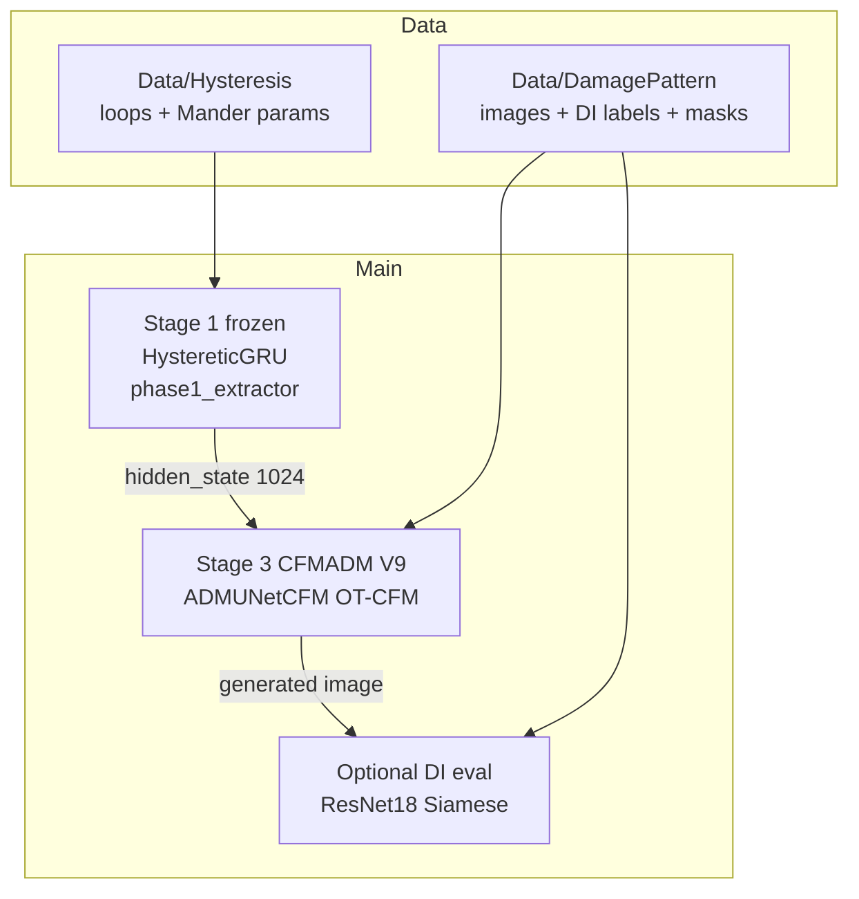
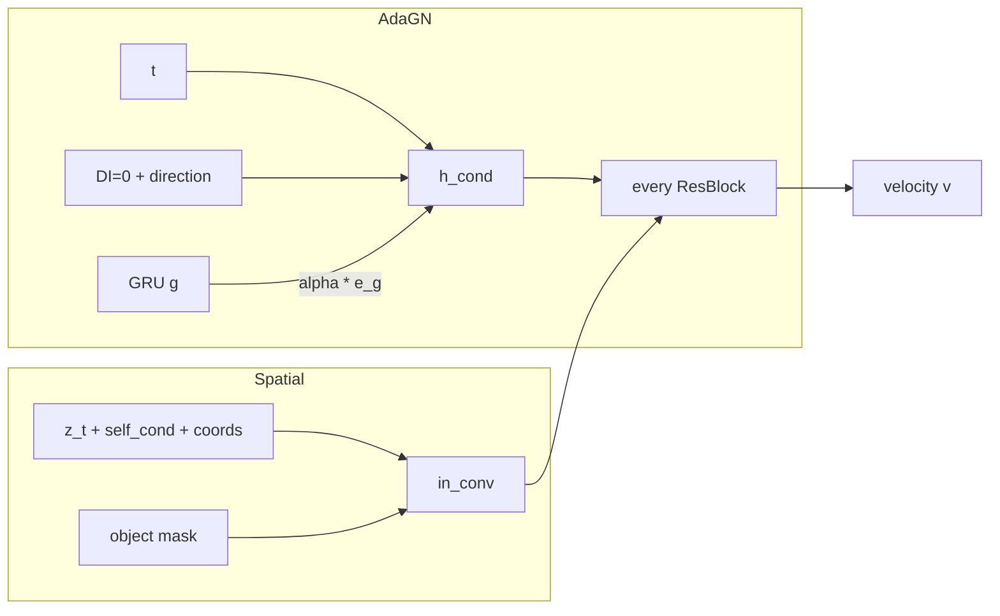
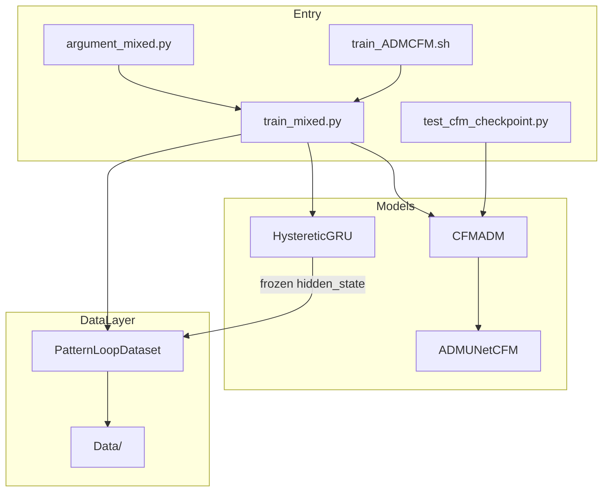

# ARCHITECTURE_UPDATE_V9

## Delta Scope (V9 Only)

V9 makes **`results/DamagePatternGeneration/CFMADM/selfcondnoDI`** the canonical Stage-3 generator. The active job is `job/DamagePatternGeneration/train_ADMCFM.sh`.

Relative to V8 (CrossAttention physics tokens on ADM U-Net) and the later Wavelet experiment:

1. **Backbone** — pixel-space `ADMUNetCFM` (not WaveletUNet)
2. **Physics injection** — GRU `g` enters AdaGN through **zero-init gated fusion** (`h_cond = e_c + α · e_g`). CrossAttention is **off**
3. **DI ablation** — `zero_di_condition=True`: the DI channel still exists but is filled with 0
4. **Self-conditioning** — architecture bool `--self_condition` / `--use_self_conditioning` (default **True**): extra `in_conv` channels, train-time Bernoulli, ODE `z₁`-hat carry
5. **Unchanged from V7/V8 spatial stack** — Patch Diffusion, object-mask `in_conv`, VSS at L3/U3

Active script flags:

```bash
--architecture CFMADM
--condition_mode split
--zero_di_condition True
--self_condition True
--use_wavelet_unet False
--use_physics_cross_attn False
--use_vss_l3_u3 True
--use_patch_diffusion True
--use_damage_mask_condition True
```

---

## Core Pipeline



| Stage | Model | Input | Output | Training script |
|-------|-------|-------|--------|-----------------|
| 1 | `HystereticGRU` | Simulated loop + material features | Force + `hidden_state [1024]` | `train_hysteresis.py` (frozen at `phase1_extractor` for generation) |
| 3 | `CFMADM` / `ADMUNetCFM` | `z_t`, coords, mask, DI(+0), direction, GRU `g` | Velocity → ODE damage image | `train_mixed.py` via `train_ADMCFM.sh` |
| Eval | `ResNet18SiameseLightning` | Generated / GT image | DI scalar, R² | `train_resnet18_siamese.py` |

Stage 2 ViT `DamageQuantification` is **not** in the V9 generation path (`add_DI_loss=False`). DI for conditioning comes from `label.csv`. Siamese is the current image-to-DI evaluator.

---

## Directory Structure (active)

```text
intership-project/
|-- argument/argument_mixed.py          # Stage-3 CLI (self_condition bool lives here)
|-- argument/argument_hysteresis.py
|-- argument/argument_resnet18_siamese.py
|-- job/DamagePatternGeneration/train_ADMCFM.sh   # V9 / selfcondnoDI
|-- job/DamagePatternGeneration/test_ADMCFM.sh
|-- src/dataset.py                      # HystereticDataset, PatternLoopDataset, DI datasets
|-- src/model/HystereticPrediction.py
|-- src/model/ImageGeneration.py        # facade → CFMADM
|-- src/model/cfm/                      # Lightning + mixins (loss, patch, ODE)
|-- src/model/Component/cfm_adm.py      # ADMUNetCFM
|-- src/model/Component/vss_block.py
|-- src/model/ResNet18_Siamese_Lightning.py
|-- train_mixed.py
|-- train_hysteresis.py
|-- test_cfm_checkpoint.py
|-- ARCHITECTURE_UPDATE_V9.md           # this file
```

Optional CFM experiments (not the default job): Laplacian-band CFM, cascade SR, VAE+MAFP, undamaged-ref, FreCaS. Historical notes: `ARCHITECTURE.md`, `ARCHITECTURE_UPDATE_V2.md`–`V8.md`.

---

## 1) Condition routing (`condition_mode=split`, gated AdaGN)

V8 routed GRU physics through CrossAttention. V9 keeps the **split** scalar/spatial/physics *sources*, but physics is fused into AdaGN.

| Route | Source | Injection | V9 |
|-------|--------|-----------|----|
| **AdaGN scalar** | `t` + **zeroed DI** + `direction` | every `AdaGNResBlock` | ON |
| **AdaGN physics** | GRU `hidden_state [1024]` | gated `α · e_g` added to AdaGN cond | ON (`α` zero-init) |
| **in_conv spatial** | object `condition_mask` | extra input channel (Zero-Conv) | ON |
| **CrossAttention** | GRU tokens at mid/U3/U2 | — | **OFF** |
| **`info` [17]** | column metadata | — | loaded, **not** used by CFM |

```text
scalar_c = cat([DI*0, direction])     # [B, 3]
gru_feat = hidden_state               # [B, 1024]

time_emb = time_mlp(sinusoidal(t))    # [B, 128]
e_c = LN(joint_mlp(time_emb + scalar_mlp(scalar_c)))
e_g = LN(Linear(gru_feat))            # 1024 → 128
h_cond = e_c + alpha * e_g            # alpha: scalar Parameter, init 0
```

`zero_di_condition=True` keeps the DI slot so the scalar MLP width stays 3, but the value is 0. Damage area is meant to come from GRU `g` (via `α`) plus spatial mask / image path.

Implementation: `build_scalar_condition`, `build_physics_condition` in `src/model/cfm/condition.py`; `ADMUNetCFM._build_cond` in `cfm_adm.py`.

---

## 2) Self-conditioning (architecture bool)

CLI (both names set the same flag):

```bash
--self_condition True          # preferred
--use_self_conditioning True   # alias, kept for older job scripts
```

Default in `argument/argument_mixed.py` is **True**. Job variable: `SELF_CONDITION=True`.

This is **not** temporal AR (`--use_ar_self_conditioning`, off in V9). It is Salimans–Ho style self-conditioning on the **current** sample.

### 2.1 Channel layout

```text
z_t_image  : [B, 3, P, P]
self_cond  : [B, 3, P, P]      # zeros, or stop-grad z1-hat
coords     : [B, 2, P, P]      # Patch Diffusion, absolute XY ∈ [-1, 1]
model_in   = cat([z_t, self_cond, coords])     # [B, 8, P, P]
+ mask     → in_conv input                     # [B, 9, P, P]
U-Net out  : [B, 5, P, P]      # image 3 + coord 2; CFM uses [:, :3]
```

Self-cond input slices of `in_conv` are **zero-initialized**, so step 0 matches a no-self-cond net until the Bernoulli path turns on.

Turning `--self_condition False` **changes `in_conv` width**. Do not load a selfcondnoDI checkpoint with the flag off.

### 2.2 Training schedule

Batch-level Bernoulli `p(step)`:

| Global step | `p` |
|-------------|-----|
| `[0, 2000)` | 0 |
| `[2000, 4000]` | linear 0 → 0.5 |
| `> 4000` | 0.5 |

When the coin is heads: no-grad pass with `self_cond=0` → `z1_hat = z_t + (1-t)·v` → second pass with `self_cond = z1_hat.detach()`. When tails: `self_cond = 0`.

### 2.3 ODE inference

Heun, 30 steps, full `128×128`. `self_cond` starts at zeros; after each step it is replaced by the current `z1_hat` and reused for the next velocity evaluation.

---

## 3) U-Net (`ADMUNetCFM`, `P=128`)

Config: `cfm_model_channels=32`, `channel_mult=(1,2,4,4)`, `num_res_blocks=1`, `cfm_cond_dim=128`, `cfm_mid_attn_heads=4`, `use_vss_l3_u3=True`.

```text
in_conv [B, 9, 128, 128] → 32

Down (AdaGN + VSS at L3)
  L0: 32 @ 128  → down 64
  L1: 64 @ 64   → down 32
  L2: 128 @ 32  → down 16
  L3: 128 @ 16 + l3_vss (VSSBlock2d)

Mid
  mid_block1 → SelfAttention2d (4 heads) → mid_block2
  (no CrossAttention)

Up (skip concat + AdaGN; VSS at U3)
  U3: 128 @ 16 + u3_vss → up 32
  U2: 128 @ 32 → up 64
  U1: 64 @ 64  → up 128
  U0: 32 @ 128

out_conv 32 → 5
pred_v = pred_full[:, :3]
```



Patch schedule (train only): 50% `128`, 30% `64`, 20% `32`. Loss is image-channel MSE only (coords dropped). Min-SNR-γ=5 on velocity. Object loss mask is **off** (mask is condition only).

---

## 4) End-to-end train / infer

```text
batch: image, hidden_state, direction, DI, condition_mask
        │
        ├─ scalar_c  = cat([0, direction])     → AdaGN
        ├─ gru_feat  = hidden_state            → gated e_g
        ├─ self_cond = 0 or z1_hat             → in_conv
        └─ condition_mask                      → in_conv
        │
        ▼
z_t = (1-t)·z0 + t·z1
v_θ(z_t, t, c, g, self_cond, mask)
L = masked-off MSE(v_θ, z1-z0) on RGB  (+ min-SNR weights)
```

Inference: same injections, all-ones mask, Heun 30, self-cond carry.

---

## 5) Active runtime config (`train_ADMCFM.sh`)

```text
Architecture:       CFMADM + ADMUNetCFM (pixel space)
Condition mode:     split, gated AdaGN, CrossAttn OFF
DI:                 channel present, values zeroed
Self-condition:     True (p=0.5 after step 4000)
VSS:                L3 + U3 only
Patch Diffusion:    ON (0.50 / 0.30 / 0.20)
Mask condition:     ON; object loss mask OFF
Wavelet U-Net:      OFF
Image size:         128
Width:              cfm_model_channels=32, cfm_cond_dim=128
Batch / steps:      128 / 15000, warmup 1000
ODE:                Heun, 30 steps
Data:               id_list_val_R307.json (val=R307, test=CTR1)
Extractor:          ./phase1_extractor (frozen GRU)
```

Reference run: `results/DamagePatternGeneration/CFMADM/selfcondnoDI/` (`args.json`, e.g. `checkpoint_step_014000.pt`).

---

## 6) Code / data flow



| Layer | Role |
|-------|------|
| `argument_mixed.py` | Flags including `--self_condition` |
| `train_mixed.py` | Load extractor, dataset, Lightning trainer |
| `src/model/cfm/` | OT-CFM loss, patch crops, ODE |
| `Component/cfm_adm.py` | U-Net + AdaGN + optional VSS / CrossAttn |

---

## 7) V8 → V9 comparison

| Aspect | V8 | V9 (selfcondnoDI) |
|--------|----|-------------------|
| Backbone | ADM U-Net | ADM U-Net (Wavelet job reverted) |
| GRU `g` | CrossAttention tokens mid/U3/U2 | Gated AdaGN `α · e_g` |
| DI | AdaGN scalar | Same slot, **values zeroed** |
| Self-conditioning | optional / off in V8 writeup | **ON** (architecture bool) |
| VSS L3/U3 | ON | ON |
| Patch Diffusion | ON | ON |
| Object mask `in_conv` | ON | ON |
| Checkpoints | V8 CrossAttn weights | **incompatible** with V8 CrossAttn / Wavelet / no-self-cond |

Train V9 from scratch, or resume a selfcondnoDI / same-flag checkpoint.

---

## 8) Removed from the repo (non-markdown)

Dead GAN / reconstruction entrypoints were deleted so the tree matches the V9 path. Markdown history (`ARCHITECTURE.md`, V2–V8, `DI_EVALUATOR_ARCHITECTURE.md`) is unchanged.

Removed examples: `test_mixed.py`, `eval_mixed.py`, `HystereticCGAN` remnants, `InteriorLoopDataset`, VQGAN/VAE reconstruction modules, `ThirdPartyDIEvaluator.py`.

Still present as **optional** (not default job): Laplacian CFM, cascade SR, Siamese / ViT DI trainers, `src/losses/lpips.py` for FID/LPIPS scripts.

---

## Technology stack (V9)

| Piece | Choice |
|-------|--------|
| Framework | PyTorch + Lightning |
| Stage 1 | Bidirectional GRU → `hidden_state` 1024 |
| Stage 3 | OT-CFM, Heun ODE |
| U-Net | ADM-style AdaGN + mid self-attention + VSS L3/U3 |
| Conditioning | split gated AdaGN, mask concat, self-cond channels |
| Tracking | CSV default; `--use_wandb` on the cluster job |

For commands, see [README.md](README.md).
